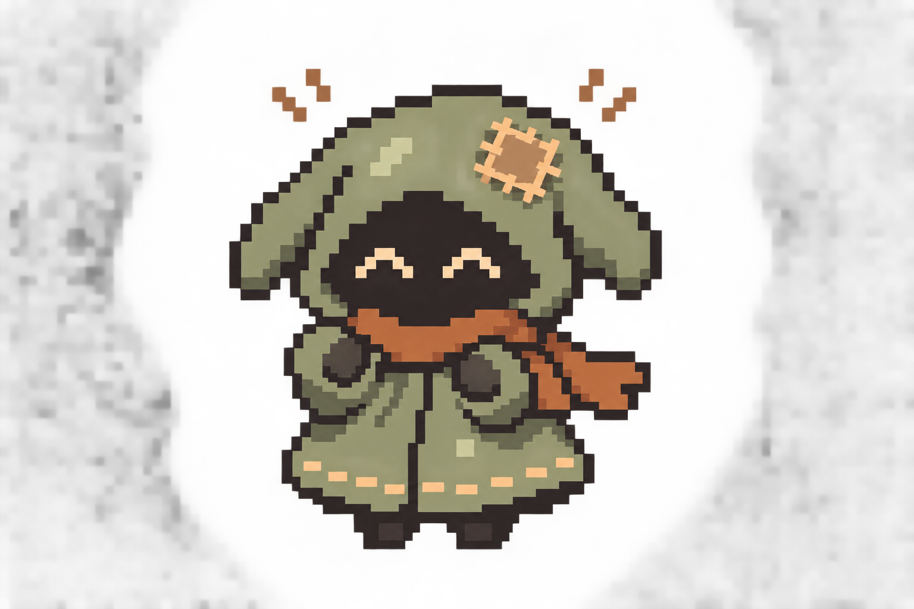
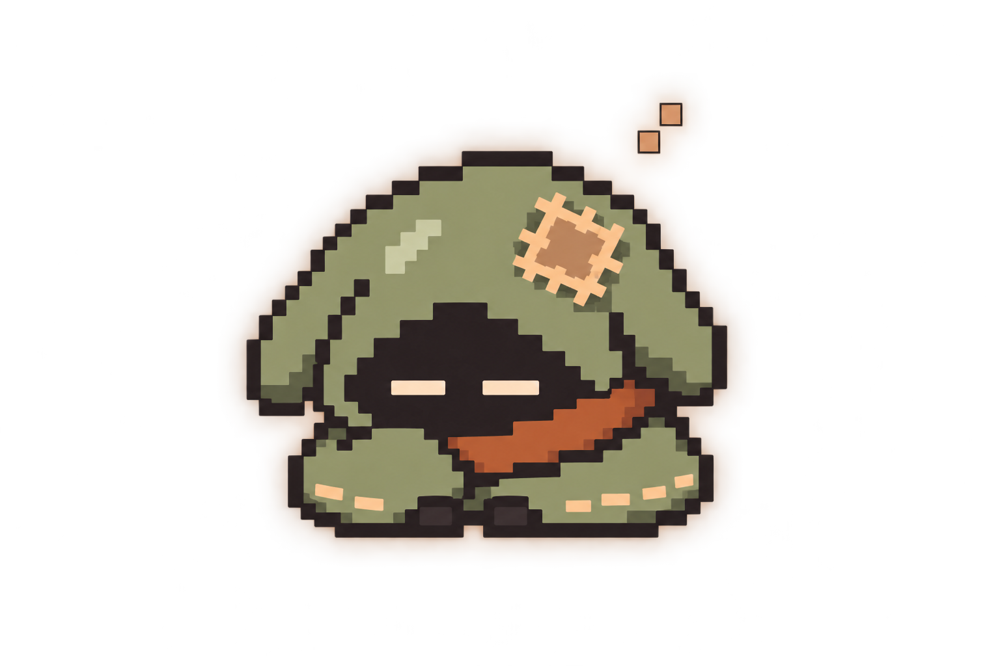

# meet moss :)
<p align="center">
  
  
</p>

gamify your todo list! I created moss because I was losing track of my todos, and the notes app just wasn't cutting it... I don't particularly enjoy the UI of apple's reminder's app, but my sister uses it, so when creating moss, I thought it would be practical to link them together. 

<p align="center">
  
  
  
</p>


## Run

Requirements: macOS 14 or later and Xcode 16 or a compatible Swift 6 toolchain.

```sh
swift run
```

To build a double-clickable local app bundle:

```sh
./scripts/package_app.sh
open dist/Moss.app
```

To build the optimized universal release bundle for both Apple silicon and
Intel Macs:

```sh
./scripts/package_release.sh
open dist/release/Moss.app
```

The release build also writes `dist/release/Moss.dSYM` for crash diagnosis.

## Controls

- Click Moss once and he will conjure up a to do list!
- Click Moss twice and the to do list will expand into your linked apple reminders list
- If Moss is getting in the way, you can drag and drop him
- Moss will fall asleep if you don't interact with him for a bit!

## Project layout

- `assets/concepts/` contains the locked visual references.
- `Sources/Moss/Resources/moss-reminder.png` is the transparent reminder sprite sheet.
- `Sources/Moss/Resources/moss-walk.png` is the four-frame transparent side-walk cycle, flipped at runtime for leftward travel.
- `Sources/Moss/Resources/moss-walk-up.png` is the matching rear-view cycle used for primarily upward movement.
- `Sources/Moss/Resources/moss-walk-down.png` is the matching front-view cycle used for straight downward movement.
- `Sources/Moss/Resources/moss-land.png` is the dedicated release-and-landing animation used after dragging.
- `Sources/Moss/Resources/moss-happy.png` is the raised-hands delighted idle loop.
- `Sources/Moss/Resources/moss-sleep.png` is the curled sleeping/breathing idle loop.
- `Sources/Moss/Resources/moss-wake.png` is the click-to-nudge sleepy wake-up sequence.
- `PetView.swift` handles sprite animation and interaction.
- `PetWindowController.swift` handles the floating transparent desktop window and wandering behavior.
- `TaskPanelWindowController.swift` provides the expanding interactive task panel.
